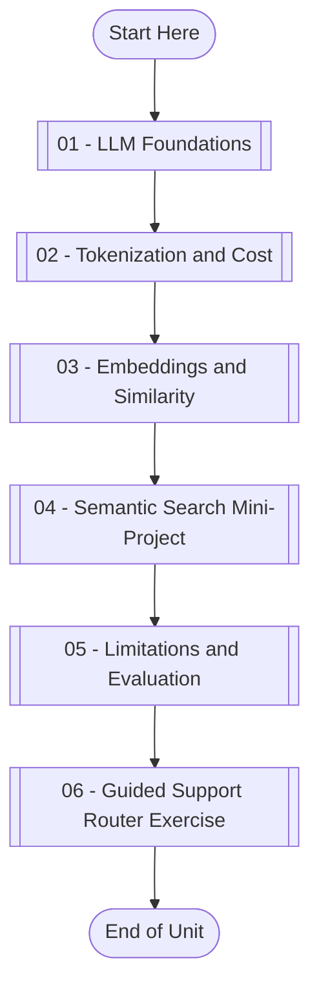

# LLMs Foundations and Embeddings

This repository provides a hands-on learning path for understanding the core operational mechanics of large language models (LLMs) and vector embeddings. It focuses on next-token prediction, tokenization and API cost estimation, vector similarity computation, and local semantic search workflows.

## Learning Path



- [[01 - LLM Foundations]](01-llm-foundations.ipynb): Trace how next-token prediction, transformer blocks, context windows, and decoding settings influence generated text.
- [[02 - Tokenization and Cost]](02-tokenization-and-cost.ipynb): Implement token counting algorithms, estimate API query costs, and plan prompt budgets.
- [[03 - Embeddings and Similarity]](03-embeddings-and-similarity.ipynb): Build text vectors locally and compare semantic relatedness using cosine similarity.
- [[04 - Semantic Search Mini-Project]](04-semantic-search-mini-project.ipynb): Retrieve top-k module candidates for user inquiries and implement confidence thresholds.
- [[05 - Limitations and Evaluation]](05-limitations-and-evaluation.ipynb): Identify typical failure modes such as hallucination, bias, prompt injection, and retrieval errors.
- [[06 - Guided Support Router Exercise]](06-guided-support-router-exercise.ipynb): Build an end-to-end support router combining token estimation, cost calculation, semantic retrieval, and risk thresholding.

## Repository Contents

- [data/course_catalog.csv](data/course_catalog.csv): Short lesson descriptions used for embedding and similarity examples.
- [data/support_questions.csv](data/support_questions.csv): Example support questions used for semantic search practice.
- Numbered notebooks at the repository root: self-contained modules with utility code, conceptual check-ins, and hands-on exercises.

## Environment

Please make sure you **use this repository as a template** and set up a new virtual environment. You can use the following commands:

Set up a fresh Python 3.11.3 virtual environment before running the notebooks. The notebooks use local CSV files and standard-library Python code, but require a local Jupyter runtime installed from `requirements.txt`. No external API keys are required.

### macOS

```bash
pyenv local 3.11.3
python -m venv .venv
source .venv/bin/activate
python -m pip install --upgrade pip
python -m pip install -r requirements.txt
```

### Windows PowerShell

```powershell
pyenv local 3.11.3
python -m venv .venv
.venv\Scripts\Activate.ps1
python -m pip install --upgrade pip
python -m pip install -r requirements.txt
```

### Windows Git Bash

```bash
pyenv local 3.11.3
python -m venv .venv
source .venv/Scripts/activate
python -m pip install --upgrade pip
python -m pip install -r requirements.txt
```

## Learning Objectives

By the end of this repository, you should be able to:

- Trace how input text is mapped to tokens, embeddings, contextual representations, logits, and generated outputs.
- Explain decoding settings (temperature, top-p) and how they control generation diversity and randomness.
- Count prompt tokens and estimate context-window usage and API consumption costs.
- Compute local text embeddings and determine vector similarity using cosine similarity metrics.
- Build a local semantic search pipeline over custom datasets.
- Implement security validation and safety guardrails to evaluate retrieval reliability and mitigate hallucination, prompt injection, and bias.

## References & Further Reading

For a deeper dive into the conceptual and mathematical foundations of this unit, see these core resources:

- **Transformer Architecture**: [Attention Is All You Need (Vaswani et al., 2017)](https://arxiv.org/abs/1706.03762) - The foundational paper introducing self-attention.
- **Subword Tokenization**: [Hugging Face Tokenizers Guide](https://huggingface.co/docs/tokenizers/index) - Explanations of modern subword algorithms (BPE, WordPiece).
- **Vector Embeddings**: [OpenAI Embeddings Guide](https://platform.openai.com/docs/guides/embeddings) - Best practices for leveraging semantic high-dimensional vectors.
